# ELEC4 - Python Activities

**Name:** Kristine Mae Peralta  
**Section:** IV-BSIT C  
**Course Code:** ELEC 4  
**Course Title:** [Enter your official course title]

## Set 1 Activities

### P1 - Student Grade Calculator
Calculates the average, highest grade, lowest grade, and student status.

Folder: [P1 Activity](set1/p1/)

Run:
```bash
python set1/p1/p1_grade_calculator.py
```

### P2 - Custom Module
Uses a custom Python module to calculate and display a student grade report.

Folder: [P2 Activity](set1/p2/)

Run:
```bash
python set1/p2/p2_main.py
```

### P3 - Student Record Manager
Manages student names using lists and sets.

Folder: [P3 Activity](set1/p3/)

Run:
```bash
python set1/p3/p3_record_manager.py
```

### P4 - Safe Menu
Demonstrates exception handling when dividing numbers and reading files.

Folder: [P4 Activity](set1/p4/)

Run:
```bash
python set1/p4/p4_exceptions.py
```


## Screenshots

### P1 - Student Grade Calculator

**Passed Output**

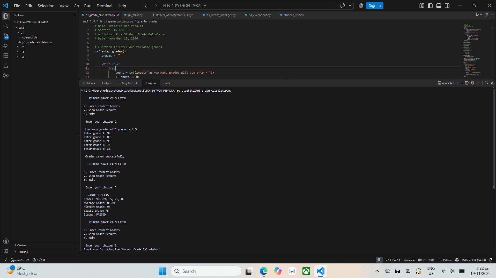

**Failed Output**

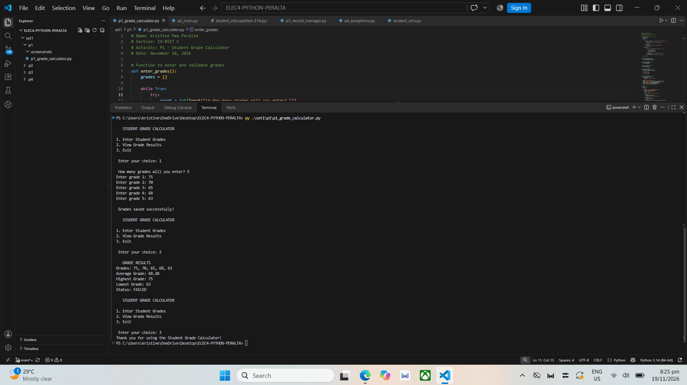

### P2 - Custom Module

**Generated Report**

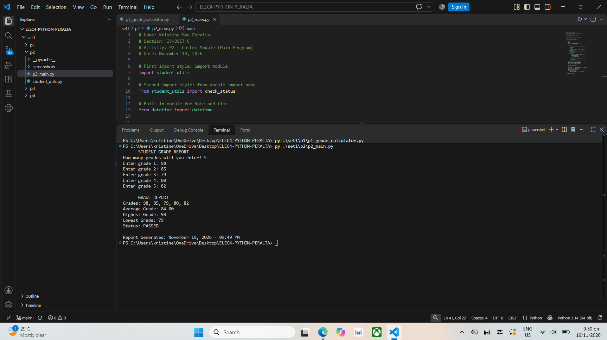

### P3 - Student Record Manager

**Add Student**

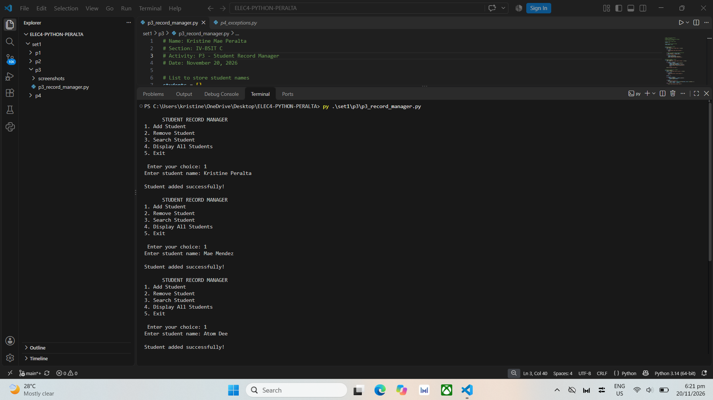

**Duplicate Prevention**

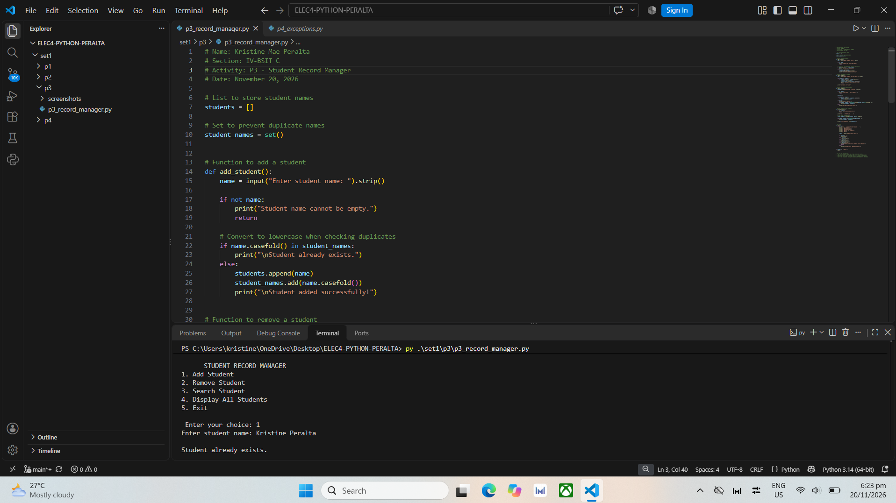

**Search Student**

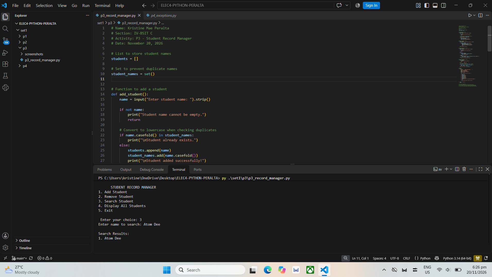

**Remove Student**

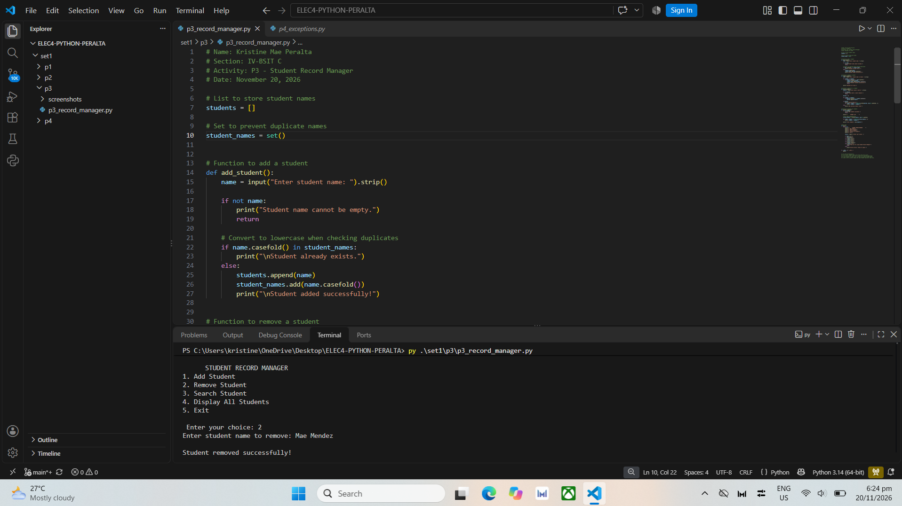

**Display Students**

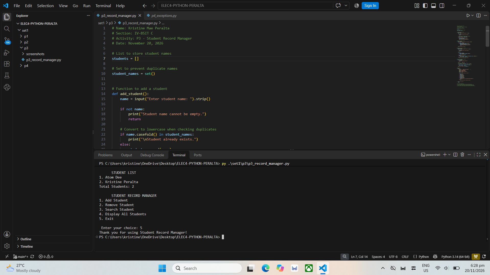

### P4 - Safe Menu

**Division by Zero**

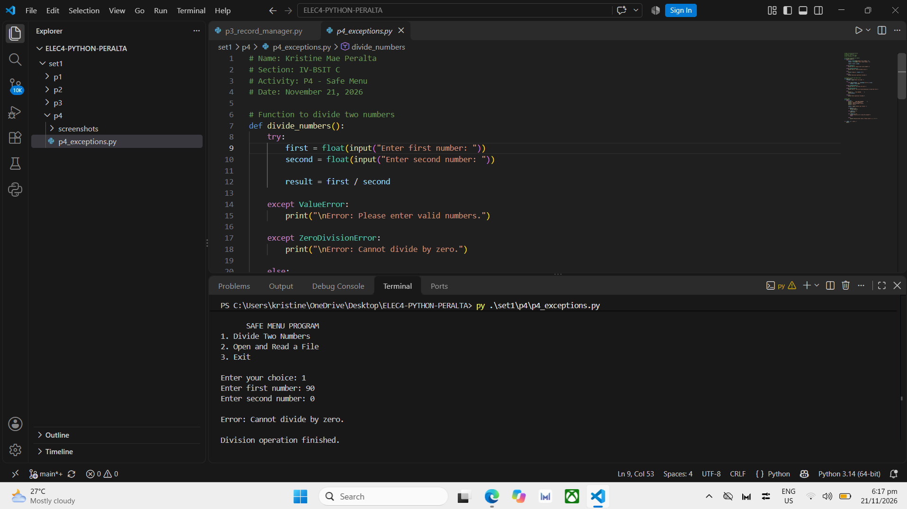

**Invalid Menu**

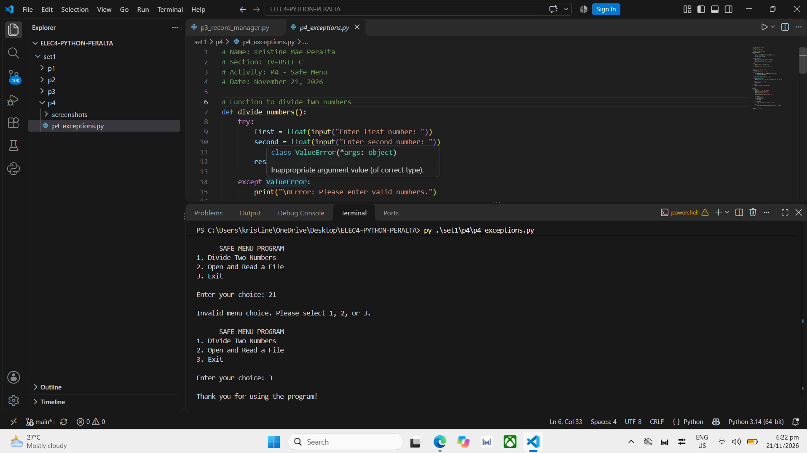

**Invalid Number**

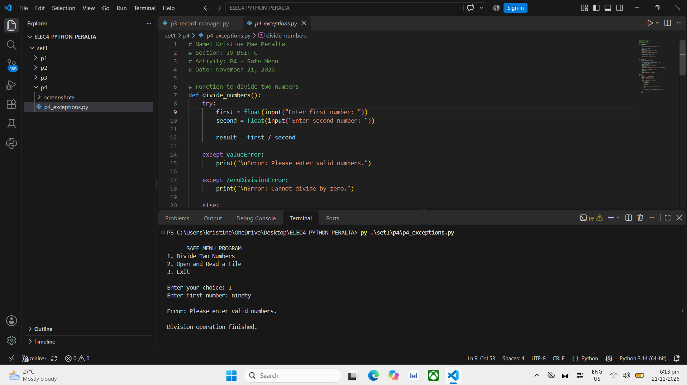

**Missing File**

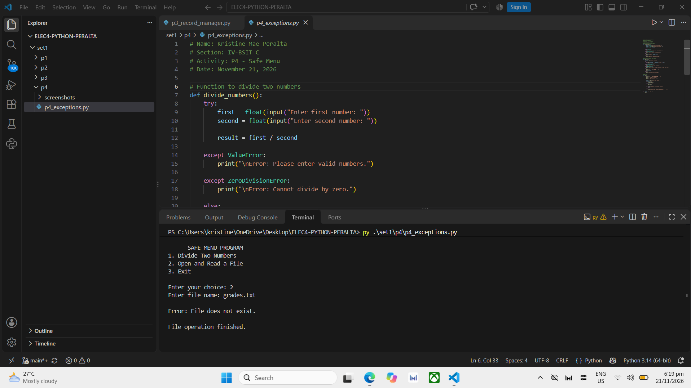